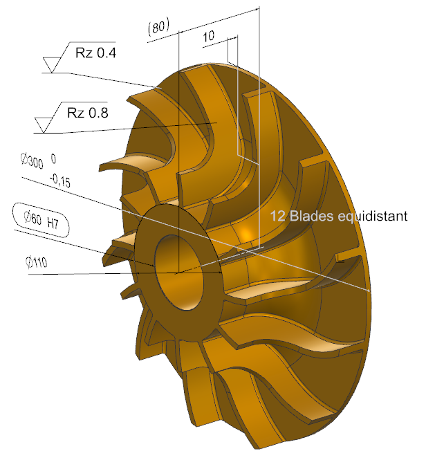

# CAD Interoperability

A C++ project for extracting and representing structured CAD data across different CAD systems and formats.

## Current Implementation

- [x] Polymorphic C++ geometry model with `std::unique_ptr` ownership
- [x] Basic Line, Circle, and Polygon import pipeline
- [x] NX Open C++ integration
- [x] Recursive NX assembly hierarchy extraction
- [x] NX component prototype and position extraction
- [x] Body / Face / Edge topology traversal
- [x] Surface and curve type classification
- [x] Feature and expression extraction
- [x] PMI dimension extraction
  - Name and value
  - Display text
  - Upper / lower tolerance
  - Inspection and reference flags
  - Associated CAD objects
- [x] PMI type classification and metadata
- [ ] Assembly constraint extraction

## Example



## Dimensions
PrintDimensions(part);

```text
=== NX Extractor ===
Work part found : rotor_60_Open_V2

Dimension [1]
 L Name : HOLE_SHAFT
 L Value : 60.000000
 L Text : 60
 L Tolerance : +0.030000/ 0.000000
 L Inspection : 1
 L Reference : 0
 L Associated Object : EDGE_HOLE_SHAFT

Dimension [2]
 L Name : TOTALHEIGHT
 L Value : 80.000000
 L Text : 80
 L Tolerance : +0.100000/ -0.100000
 L Inspection : 0
 L Reference : 0
 L Associated Object : EXTRUSION_CENTER
...
```

## PMI
PrintPMIData(part);

```text
=== NX Extractor ===
Work part found : rotor_60_Open_V2
...
PMI [8]
 L Name : Note_EdgeCond
 L Type : Edge Condition
 L Index : 10
 L Display Instances :1
 L Mirrored : 0
 L Business Modifiers : 0

PMI [9]
 L Name : Centerline_HoleShaft
 L Type : Centerline
 L Index : 11
 L Display Instances :1
 L Mirrored : 0
 L Business Modifiers : 0
 L Associated Object [1] : SURFACE_HOLE_SHAFT

PMI [10]
 L Name : SurfaceFinish_HoleShaft
 L Type : Surface Finish
 L Index : 12
 L Display Instances :1
 L Mirrored : 0
 L Business Modifiers : 0
...
```
